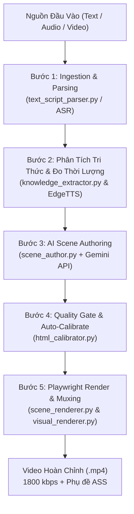

# AI Lecture Illustrator Engine (Minh Họa Bài Giảng AI)

> **Tài liệu kiến trúc, quy trình vận hành toàn trình (End-to-End Workflow) và quy chuẩn giao kèo (Strict Contracts)**  
> Dành cho AI Agents và Kỹ sư phát triển: Đọc tệp này để nắm toàn bộ bức tranh kiến trúc, luồng điều phối, quy tắc thẩm mỹ và phương pháp kiểm thử của module.

---

## 🏛️ 1. Bản Chất & Kiến Trúc Tổng Quan (Module Overview)

Module **AI Lecture Illustrator** chuyển đổi các nội dung bài giảng giáo dục, quy trình công nghệ, thuật toán hoặc tài liệu thuyết minh từ **Văn bản (`.txt`, `.md`), Âm thanh (`.mp3`, `.wav`) hoặc Video (`.mp4`)** thành **Video giáo dục sinh mới hoàn toàn** với hoạt cảnh vẽ tay trên giấy và thuyết minh lồng tiếng đồng bộ câu.

### 🌟 Bước Chuyển Dịch Kiến Trúc Quan Trọng
- **Kiến trúc cũ (Bị loại bỏ)**: Dùng 22 template HTML tĩnh (`title_point`, `bullet_list`, `algo_array`...) và thư viện ngoài `rough.js` kết hợp slot-filling thô sơ. Kém linh hoạt, giới hạn khả năng diễn họa trực quan.
- **Kiến trúc mới hiện tại (Pure Native AI-Authored SVG/HTML Scene Engine)**:
  - AI (Gemini `gemini-3.8-flash` / LLM) đóng vai trò **Họa Sĩ & Kỹ Sư Đồ Họa Độc Lập**, trực tiếp sinh mã HTML tự chứa 100% (SVG + CSS + JS thuần) cho từng phân cảnh dựa trên **Master Prompt chuẩn hóa** (`prompts/paper-1.md`).
  - **Zero External Dependencies**: Hoàn toàn không phụ thuộc thư viện bên ngoài (không dùng Rough.js, Anime.js, GSAP, Canvas-confetti). Mã thuần native đảm bảo tính ổn định và tốc độ render siêu tốc.
  - **Automated Headless Quality Gate**: Tích hợp tool trọng tài tự động ([html_calibrator.py](file:///Users/voquyt/Documents/projects/video/Sub-Video/py_engine/lecture_illustrator/html_calibrator.py)) kiểm tra 4 tiêu chuẩn vàng (Timing, Subtitle Zone, Min-Font, Anti-Overlap) và tự động vi điều chỉnh (auto-calibrate) để đạt điểm tuyệt đối 100/100.

---

## 🎨 2. Triết Lý Thẩm Mỹ & Quy Tắc Tương Phản (Art Direction & Color Rules)

### 2.1 Bản Sắc Sổ Tay Vẽ Tay Sư Phạm (Hand-drawn Educational Notebook)
- **Cảm giác thị giác**: Nhẹ nhàng, mộc mạc, sư phạm, kích thích tư duy học tập. Tuyệt đối **không biến màn hình thành "bảng báo động khẩn cấp" hay "hiện trường sự cố kinh hoàng"** với các mảng màu đỏ, xanh chói gắt.
- **Bảng màu CSS Variables chuẩn trong `:root`**:
  ```css
  :root {
    --paper: #f6f3eb;        /* Nền giấy kem ấm áp */
    --card-bg: #ffffff;      /* Nền thẻ màu trắng tinh khiết */
    --ink: #26323d;          /* Màu mực than chì đậm (Contrast > 13:1 trên trắng) */
    --ink-muted: #52616b;    /* Màu mực phụ cho chú thích, vạch ngăn cách */
    --accent-warm: #d97706;  /* Màu chì cam/hổ phách ấm áp */
    --accent-red: #c2410c;   /* Màu đỏ gạch/đất nung dịu nhẹ (dùng cho lỗi/sự cố) */
    --accent: #c2410c;       /* Điểm nhấn chính */
    --accent-green: #15803d; /* Màu xanh lá cây tự nhiên (trạng thái bình thường) */
    --accent-blue: #2563eb;  /* Màu xanh dương kỹ thuật (luồng request/dữ liệu) */
  }
  ```

### 2.2 Quy Tắc Tương Phản Chuẩn (True Contrast Invariant)
- **Định nghĩa chuẩn**: *"Màu nền của box KHÔNG ĐƯỢC cùng tone với màu chữ là được."*
- **Quy tắc 95%**: Hầu hết các thẻ là **nền trắng tinh khiết (`#ffffff`)** đi kèm **chữ màu mực than chì (`#26323d`)**. Bố cục này tạo độ tương phản xuất sắc ($> 13:1$), cực kỳ sáng rõ, trong trẻo và dễ đọc trên mọi thiết bị.
- **Nghiêm cấm tuyệt đối (Strictly Forbidden)**:
  - ❌ CẤM tô màu nền của card thành các mảng đỏ, hồng đỏ (`#fef2f2`), xanh lam đậm hay xanh lá đậm.
  - ❌ CẤM làm viền card dày cộp màu đỏ rực cho toàn bộ khung hộp lớn.
  - ❌ CẤM dán các thanh banner khổng lồ màu đỏ thẫm đặc quánh (`#991b1b`) đè lên đầu card.
  - ❌ CẤM đổi toàn bộ chữ trong box sang màu đỏ hoặc xanh.

### 2.3 Thể Hiện Lỗi / Sự Cố Tinh Tế (Subtle & Elegant Error Representation)
- Khi máy chủ sập hoặc ngắt kết nối:
  - Khung card **vẫn giữ nền trắng (`#ffffff`) và viền mực than chì bình thường (`#26323d`)**, có thể chuyển nét viền sang nét đứt nhẹ (`stroke-dasharray="6 4"`).
  - Chỉ dùng **duy nhất 1 điểm nhấn nhỏ (Micro-Accent)**: Biểu tượng tia sét vẽ tay nhỏ màu cam đất dịu (`#d97706` hoặc `#c2410c`, nét mỏng 2px), hoặc dấu X nhỏ, hoặc nhãn text ngắn gọn màu mực than chì.
  - Mũi tên ngắt kết nối: Chuyển sang nét đứt xám chì (`#94a3b8`) với dấu gạch chéo `✕` nhỏ ở giữa, không nhuộm đỏ toàn bộ mũi tên.

### 2.4 Chuyển Đổi Trạng Thái Sạch Sẽ (Clean State Transitions)
- Khi một đối tượng chuyển từ trạng thái Bình Thường sang trạng thái Sự Cố (Normal $\rightarrow$ Crashed):
  - Toàn bộ các phần tử thuộc trạng thái Bình Thường (hình rack máy chủ, các dòng chữ chức năng cũ) **BẮT BUỘC phải ẩn hoàn toàn** (`setEntityOpacity(..., 0)` hoặc `opacity: 0; visibility: hidden;`).
  - Trạng thái Mới xuất hiện độc lập, **tuyệt đối không để chữ hoặc icon của trạng thái mới đè chồng chéo lên trạng thái cũ**.

### 2.5 Hạt Chạy Thể Hiện Luồng (Flow Dots)
- Các đường truyền dữ liệu, kết nối Client - Server bắt buộc có các hạt tròn nhỏ (`<circle r="7..9">`) di chuyển dọc theo vector path (`path.getPointAtLength()`) để người xem trực quan thấy dòng chảy request.
- Khi ngắt kết nối hoặc có lỗi: Các hạt chạy lập tức biến mất (`opacity: 0`).

---

## 🔄 3. Workflow Toàn Trình (End-to-End Pipeline)

Quy trình xử lý của module đi qua 5 bước tuần tự:



### Bước 1: Thu Nhận & Phân Tách Kịch Bản (`text_script_parser.py`)
- Nếu là **Văn bản (`.txt`, `.md`)**: Bỏ qua ASR, bóc tách cấu trúc Markdown, ngắt câu tự nhiên hoặc dùng AI biên tập kịch bản từ tài liệu thô (`--raw-article`).
- Nếu là **Âm thanh (`.mp3`, `.wav`)**: Chạy Whisper MLX trích xuất văn bản và timestamps.
- Nếu là **Video (`.mp4`)**: Tách âm thanh và chạy Whisper ASR.

### Bước 2: Phân Tích Tri Thức & Đo Thời Lượng Thật (`knowledge_extractor.py` & TTS)
- Gom các câu thoại thành các phân đoạn ngữ nghĩa (**Semantic Batches**, tối đa 6 câu/batch).
- Tạo giọng đọc AI (EdgeTTS: Ban Mai / Hoài My) để lấy **mốc thời gian bắt đầu câu $t_k$ thực tế** và thời lượng chính xác của phân cảnh.

### Bước 3: AI Scene Authoring (`scene_author.py`)
- Nạp Master Blueprint Prompt từ [prompts/paper-1.md](file:///Users/voquyt/Documents/projects/video/Sub-Video/py_engine/lecture_illustrator/prompts/paper-1.md) (hoặc [master_handdrawn_animation_prompt.md](file:///Users/voquyt/Documents/projects/video/Sub-Video/py_engine/lecture_illustrator/prompts/master_handdrawn_animation_prompt.md)).
- Ghép kịch bản chi tiết: Title, Aspect Ratio (16:9 / 9:16), Duration, Danh sách câu thoại & timestamps thực tế $t_k$.
- Gọi Google Gemini REST API (`gemini-3.8-flash` với timeout 180s) sinh mã HTML tự chứa 100%.

### Bước 4: Kiểm Định Chất Lượng & Vi Cân Chỉnh Tự Động (`html_calibrator.py`)
- Khởi động Chromium Headless Playwright để kiểm tra DOM thực tế:
  1. **Timing Contract (25đ)**: Kiểm tra sự tồn tại và tính hợp lệ của `window.__renderAt(t, stepStarts)`.
  2. **Subtitle Safety Zone (25đ)**: Đo tọa độ thực tế $\max(y)$. Bắt buộc $\le 840\text{ px}$ (cho 16:9) hoặc $\le 1620\text{ px}$ (cho 9:16) để chừa chỗ cho phụ đề video.
  3. **Text Legibility (25đ)**: Kiểm tra cỡ chữ nhỏ nhất $\ge 20\text{ px}$. Nếu phát hiện chữ nhỏ, calibrator tự động nắn chỉnh (`clamped_min_font_22px`).
  4. **Anti-Overlap (25đ)**: Bounding-box AABB intersection kiểm tra không có chữ đè lên nhau hay mũi tên đâm xuyên ruột thẻ.
- Điểm chất lượng $\ge 90/100$ được chấp thuận; nếu có lỗi nghiêm trọng, engine kích hoạt Reflection Loop để AI chỉnh sửa.

### Bước 5: Render Khung Hình & Xuất Video (`scene_renderer.py`, `visual_renderer.py`)
- **Playwright Virtual Time Clock**: Tua thời gian chính xác theo từng frame 24 FPS bằng `window.__renderAt(t, stepStarts)`.
- **Smart Resume Manifest (`.batch_manifest.json`)**: Lưu mã băm MD5 của từng batch. Khi người dùng chỉnh sửa 1 cảnh trong dự án, hệ thống chỉ render lại duy nhất cảnh đó và tái sử dụng các clip cũ, hoàn tất xuất video trong vài giây.
- **Single-Pass Concat & Burn Subtitle**: Ghép các clip batch, trộn audio TTS và đè phụ đề ASS chuẩn xác theo từng câu thoại. Xuất video tối ưu bitrate 1800 kbps (CRF 23, `-tune animation`).

---

## 📜 4. Giao Kèo Kỹ Thuật Bắt Buộc (Strict Invariants & Contracts)

Mọi tệp HTML cảnh do AI sinh ra hoặc template tạo ra bắt buộc phải tuân thủ 5 giao kèo bất biến sau:

1. **Playwright Virtual Time Hook**:
   ```javascript
   window.__renderAt = function(t, stepStarts) {
     if (autoPlayLoopId) {
       cancelAnimationFrame(autoPlayLoopId);
       autoPlayLoopId = null;
     }
     isExternalControl = true;
     renderScene(Number(t), stepStarts);
   };
   ```
   - Dòng đầu tiên của `window.__renderAt` bắt buộc phải gọi `cancelAnimationFrame` để nhường quyền điều khiển thời gian tuyệt đối cho Playwright.
   - Nghiêm cấm dùng `setTimeout` và `setInterval`.
2. **Vùng Cấm Phụ Đề Đáy (No-Draw Subtitle Exclusion Zone)**:
   - Tỷ lệ 16:9 ($1920 \times 1080$): Toàn bộ nét vẽ, card, icon và text **phải kết thúc trước $y = 840\text{ px}$** (chừa $240\text{ px}$ cho phụ đề).
   - Tỷ lệ 9:16 ($1080 \times 1920$): Toàn bộ nét vẽ **phải kết thúc trước $y = 1620\text{ px}$** (chừa $300\text{ px}$ cho phụ đề).
3. **Cỡ Chữ Chuẩn Mobile (Mobile-First Min-Font)**:
   - Tiêu đề chính: $40 - 44\text{ px}$.
   - Tiêu đề Card/Node: $28 - 34\text{ px}$.
   - Nhãn nội dung: $20 - 24\text{ px}$.
   - Sàn tuyệt đối: Không phần tử nào có cỡ chữ $< 20\text{ px}$.
4. **Bố Cục Gom Cụm Trung Tâm (Centrally Clustered — 70% to 80% Occupancy)**:
   - Các card và sơ đồ gom quanh tâm $x_{\text{mid}} = 960\text{ px}$, chiếm từ 70% đến 80% diện tích khả dụng.
   - Khoảng cách giữa các cột từ $140\text{ px} - 220\text{ px}$. Tuyệt đối cấm ghim card sát 2 mép biên để lại khoảng trống chết khổng lồ ở giữa.
5. **Zero-Truncation**:
   - Tuyệt đối không dùng dấu ba chấm `...` hay cắt cụt chuỗi hiển thị.

---

## 🧪 5. Quy Trình Kiểm Thử & Tinh Chỉnh Dành Cho AI Agent (Agent Testing Protocol)

> ⚠️ **ĐIỀU RĂN TỐI THƯỢNG CHO MỌI AI AGENT KHI LÀM VIỆC VỚI MODULE NÀY**:
> - **AGENT TUYỆT ĐỐI KHÔNG ĐƯỢC PHÉP SỬA MÃ TRỰC TIẾP TRÊN FILE OUTPUT HTML!**
> - Không được dùng tool `replace_file_content` hay `write_to_file` để tự tay gõ mã HTML cảnh nhằm vượt qua test.
> - **Mục tiêu của hệ thống là kiểm tra và hoàn thiện khả năng tự sinh của AI, không phải khả năng gõ code HTML thủ công của Agent.**

### Quy Trình Chuẩn Để Sửa Lỗi / Nâng Cấp Chất Lượng Output:
```text
1. Phát hiện vấn đề về bố cục, màu sắc, font chữ hoặc chuyển động.
2. Tinh chỉnh trực tiếp vào System Prompt Template:
   - py_engine/lecture_illustrator/prompts/paper-1.md
   - py_engine/lecture_illustrator/prompts/master_handdrawn_animation_prompt.md
3. Chạy test script (ví dụ: scratch/run_ai_generation_and_eval.py) gọi author_scene_with_retry:
   - Prompt nạp từ file template -> Gọi Gemini API -> AI sinh HTML thô.
   - Tool evaluate_and_calibrate_scene_html tự động chạy các vi chỉnh đã thống nhất (min font, safe zone).
4. Playwright tự động render và chụp ảnh screenshot tại các mốc thời gian (Beats).
5. Agent quan sát ảnh screenshot để nghiệm thu và kiểm chứng đóng vòng.
```

---

## 📂 6. Bản Đồ File Mã Nguồn Trong Module (`py_engine/lecture_illustrator/`)

| Tên File | Vai Trò & Nghiệp Vụ Chính | Hàm Quan Trọng |
|---|---|---|
| [scene_author.py](file:///Users/voquyt/Documents/projects/video/Sub-Video/py_engine/lecture_illustrator/scene_author.py) | Điều phối AI viết mã HTML tự chứa, Reflection loop tự sửa lỗi | `author_scene_with_retry()`, `build_scene_author_prompt()` |
| [html_calibrator.py](file:///Users/voquyt/Documents/projects/video/Sub-Video/py_engine/lecture_illustrator/html_calibrator.py) | Trọng tài Playwright DOM & Tự động vi điều chỉnh Quality Gate | `evaluate_and_calibrate_scene_html()` |
| [knowledge_extractor.py](file:///Users/voquyt/Documents/projects/video/Sub-Video/py_engine/lecture_illustrator/knowledge_extractor.py) | Bóc tách ngữ nghĩa bài giảng, gọi Gemini API qua REST | `extract_lecture_knowledge()`, `call_llm_api()` |
| [scene_renderer.py](file:///Users/voquyt/Documents/projects/video/Sub-Video/py_engine/lecture_illustrator/scene_renderer.py) | Điều khiển Playwright virtual time seek và chụp frame 24 FPS | `render_html_scene_to_video()` |
| [visual_renderer.py](file:///Users/voquyt/Documents/projects/video/Sub-Video/py_engine/lecture_illustrator/visual_renderer.py) | Smart Resume Manifest MD5, Single-Pass Batch Muxing & Export | `render_lecture_video()` |
| [text_script_parser.py](file:///Users/voquyt/Documents/projects/video/Sub-Video/py_engine/lecture_illustrator/text_script_parser.py) | Đọc file text/markdown, ngắt câu, parse script bài giảng | `parse_lecture_input_source()` |
| [subtitles.py](file:///Users/voquyt/Documents/projects/video/Sub-Video/py_engine/lecture_illustrator/subtitles.py) | Sinh file phụ đề ASS chuẩn xác khớp mốc thời gian TTS | `generate_lecture_subtitles()` |
| [models.py](file:///Users/voquyt/Documents/projects/video/Sub-Video/py_engine/lecture_illustrator/models.py) | Data classes: `LectureProject`, `LectureBatch`, `LectureProjectConfig` | `LectureProject.from_dict()` |
| [prompts/paper-1.md](file:///Users/voquyt/Documents/projects/video/Sub-Video/py_engine/lecture_illustrator/prompts/paper-1.md) | **Master Prompt Tinh Gọn (Single Source of Truth cho AI Author)** | Chứa quy tắc thẩm mỹ, tương phản, layout, boilerplate |
